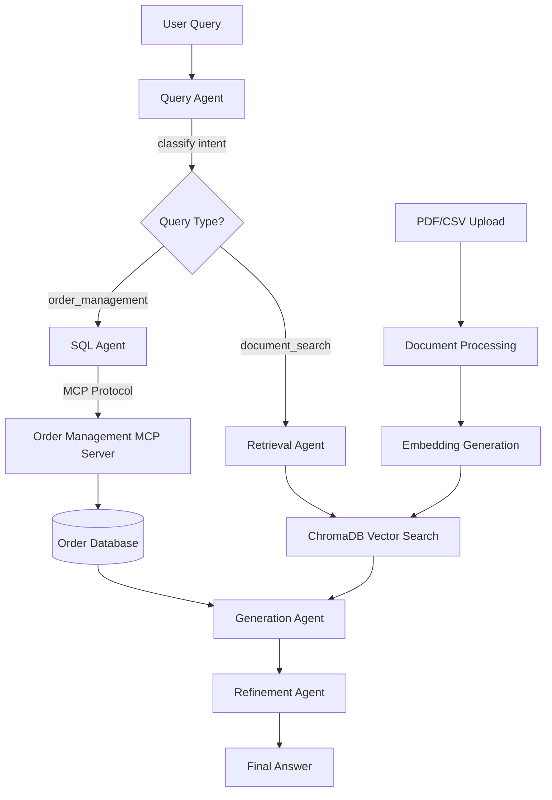

# OmniHelp - RAG Application with Order Management

**Retrieval-Augmented Generation Application with Langgraph, FastAPI, ChromaDB, and MCP Integration**

A production-ready RAG (Retrieval-Augmented Generation) application that supports:

- PDF and CSV document ingestion
- Intelligent query processing with multi-step agent workflows
- **Order Management System via MCP (Model Context Protocol) integration**
- Conditional routing between document search and database queries

## 🎯 New: Order Management Integration

This application now features a dual-mode query system:

1. **Document Search Mode**: RAG-based queries against uploaded documents
2. **Order Management Mode**: SQL-based queries against an order database via MCP server

The system automatically classifies queries and routes them to the appropriate handler!

## 🏗️ Architecture



## 🛠️ Tech Stack

### Backend Application

- **Python 3.11+**: Latest Python features
- **FastAPI**: Modern, fast web framework
- **Langgraph**: Agent orchestration and workflow management
- **LangChain**: LLM integration and RAG capabilities
- **ChromaDB**: Vector database for embeddings
- **OpenAI**: LLM and embeddings (GPT-4, text-embedding-3-small)

### Order Management MCP Server

- **MCP (Model Context Protocol)**: Standardized server-client communication
- **SQLAlchemy**: Database ORM
- **SQLite**: Lightweight database (easily swappable for PostgreSQL/MySQL)
- **Pydantic**: Data validation and settings management

## 📁 Project Structure

```
OmniHelp/
├── order_management_mcp/        # 🆕 MCP Server (separate service)
│   ├── server.py                # MCP server implementation
│   ├── database.py              # SQLAlchemy models & data
│   ├── config.py                # Server configuration
│   ├── requirements.txt         # Server dependencies
│   ├── README.md                # Server documentation
│   └── data/                    # SQLite database
│       └── orders.db           # Order management DB
├── backend/
│   ├── app/
│   │   ├── agents/              # Langgraph agents
│   │   │   ├── query_agent.py   # Query classification (🆕 order intent)
│   │   │   ├── retrieval_agent.py # Vector search
│   │   │   ├── sql_agent.py     # 🆕 SQL/MCP agent
│   │   │   ├── generation_agent.py # Answer generation
│   │   │   ├── refinement_agent.py # Answer refinement
│   │   │   └── orchestrator.py  # 🆕 Conditional routing
│   │   ├── services/            # Business logic
│   │   │   ├── mcp_client_service.py # 🆕 MCP client
│   │   │   ├── document_service.py
│   │   │   ├── chunking_service.py
│   │   │   └── embedding_service.py
│   │   ├── api/v1/              # FastAPI routes
│   │   ├── core/                # Configuration
│   │   ├── db/                  # Database layer
│   │   ├── models/              # Data models
│   │   └── main.py              # FastAPI app
│   └── requirements.txt
├── tests/                       # Test suite
│   ├── test_agents.py           # 🆕 Order classification tests
│   ├── test_mcp_client.py       # 🆕 MCP client tests
│   ├── test_sql_agent.py        # 🆕 SQL agent tests
│   └── test_api.py
├── setup.sh                     # 🆕 Quick setup script
├── IMPLEMENTATION_SUMMARY.md    # 🆕 Implementation details
└── README.md
```

## 🚀 Quick Start

### Automated Setup (Recommended)

```bash
# Run the setup script
./setup.sh
```

### Manual Setup

#### 1. Setup MCP Server

```bash
cd order_management_mcp
python -m venv venv
source venv/bin/activate  # On Windows: venv\Scripts\activate
pip install -r requirements.txt
```

#### 2. Setup Backend

```bash
cd backend
python -m venv venv
source venv/bin/activate
pip install -r requirements.txt
```

#### 3. Configure Environment

**Backend `.env`:**

```env
OPENAI_API_KEY=your_openai_api_key_here
OPENAI_MODEL=gpt-4o-mini
OPENAI_EMBEDDING_MODEL=text-embedding-3-small

# MCP Server Settings
MCP_SERVER_HOST=localhost
MCP_SERVER_PORT=8001
MCP_SERVER_ENABLED=true
```

**MCP Server `.env` (optional):**

```env
MCP_PORT=8001
MCP_HOST=localhost
ORDER_DB_PATH=./data/orders.db
ALLOW_WRITE_OPERATIONS=false
```

### Running the Application

**Terminal 1 - Start MCP Server:**

```bash
cd order_management_mcp
source venv/bin/activate
python -m order_management_mcp
```

**Terminal 2 - Start Backend:**

```bash
cd backend
source venv/bin/activate
python -m app.main
```

The application will be available at:

- Backend API: http://localhost:8000
- API Docs: http://localhost:8000/docs
- Health Check: http://localhost:8000/health

## 📖 Usage

### 🆕 Order Management Queries

The system automatically detects and routes order-related queries:

```bash
curl -X POST "http://localhost:8000/api/v1/query" \
  -H "Content-Type: application/json" \
  -d '{
    "query": "What is the status of order #1?"
  }'
```

**Example Order Queries:**

- "What is the status of order #123?"
- "Show me all orders for John Doe"
- "How many laptops are in stock?"
- "What products do we have available?"
- "Get details for order 2"

**Response:**

```json
{
  "answer": "Order #1 is currently shipped with a total of $299.99...",
  "sources": ["Order Management System"],
  "metadata": {
    "intent": "order_management",
    "refined": true
  }
}
```

### 1. Upload Documents

**Upload a PDF:**

```bash
curl -X POST "http://localhost:8000/api/v1/documents/upload" \
  -F "file=@document.pdf"
```

**Upload a CSV:**

```bash
curl -X POST "http://localhost:8000/api/v1/documents/upload" \
  -F "file=@data.csv"
```

**Response:**

```json
{
  "document_id": "uuid-here",
  "filename": "document.pdf",
  "document_type": "pdf",
  "chunks": 45,
  "file_path": "./data/documents/uuid_document.pdf"
}
```

### 2. Query Documents (RAG Mode)

**Submit a document search query:**

```bash
curl -X POST "http://localhost:8000/api/v1/query" \
  -H "Content-Type: application/json" \
  -d '{
    "query": "What is machine learning?",
    "n_results": 5
  }'
```

**Example Document Queries:**

- "What are the benefits of our product?"
- "Explain the return policy"
- "How does machine learning work?"

**Response:**

```json
{
  "answer": "Machine learning is...",
  "sources": ["document.pdf", "another.pdf"],
  "retrieved_chunks": [...],
  "metadata": {
    "intent": "document_search",
    "refined": true,
    "sources_count": 2
  }
}
```

### 3. List Documents

```bash
curl -X GET "http://localhost:8000/api/v1/documents/"
```

### 4. Delete Document

```bash
curl -X DELETE "http://localhost:8000/api/v1/documents/{document_id}"
```

## 🔄 How It Works

### Intelligent Query Routing

1. **Query Classification**: LLM analyzes the query to determine intent

   - `order_management`: Orders, products, inventory, customers
   - `document_search`: General knowledge from uploaded documents
   - `metadata_filter`: Specific document queries
   - `general`: Conversational queries

2. **Conditional Routing**: Based on intent:

   - **Order queries** → SQL Agent → MCP Server → Order Database
   - **Document queries** → Retrieval Agent → ChromaDB → Documents

3. **Unified Generation**: Both paths converge at the generation agent for consistent responses

### Document Processing Flow

1. **Upload**: PDF or CSV file is uploaded via API
2. **Parsing**:
   - PDF: Text extraction using pypdf
   - CSV: Each row converted to text with column context
3. **Chunking**: Text split into chunks (configurable size/overlap)
4. **Embedding**: Generate embeddings using OpenAI
5. **Storage**: Store chunks with metadata in ChromaDB

### Query Processing Flow

1. **Query Classification**: Analyze intent (order vs document)
2. **Conditional Routing**:
   - Order Management: Call MCP server tools
   - Document Search: Vector similarity search in ChromaDB
3. **Generation**: LLM generates answer from retrieved context
4. **Refinement**: Answer is refined and validated
5. **Response**: Final answer returned with sources and metadata

### Order Management Features

- **Sample Database**: Pre-populated with customers, products, and orders
- **6 MCP Tools**: Order status, customer orders, inventory, custom SQL, etc.
- **Natural Language**: Convert questions to SQL automatically
- **Safety**: Read-only by default, SQL injection protection
- **Extensible**: Easy to add PostgreSQL/MySQL support

## 🧪 Testing

Run all tests:

```bash
cd backend
pytest tests/
```

Run specific test suites:

```bash
pytest tests/test_agents.py          # Query classification
pytest tests/test_mcp_client.py      # MCP client integration
pytest tests/test_sql_agent.py       # SQL agent logic
```

Run with coverage:

```bash
pytest tests/ --cov=app --cov-report=html
```

## 🔍 Monitoring

Check system health:

```bash
curl http://localhost:8000/health
```

Expected response:

```json
{
  "status": "healthy",
  "documents": 10,
  "mcp_server": "connected"
}
```

## ⚙️ Configuration

### Backend Configuration (`.env`)

```env
# OpenAI (Required)
OPENAI_API_KEY=your_key_here
OPENAI_MODEL=gpt-4o-mini
OPENAI_EMBEDDING_MODEL=text-embedding-3-small

# MCP Server
MCP_SERVER_HOST=localhost
MCP_SERVER_PORT=8001
MCP_SERVER_ENABLED=true

# Database
CHROMA_DB_PATH=./data/chroma_db
CHUNK_SIZE=1000
CHUNK_OVERLAP=200
MAX_FILE_SIZE_MB=50

# Logging
LOG_LEVEL=INFO
LOG_FILE=./logs/app.log
```

### MCP Server Configuration (`.env`)

```env
MCP_PORT=8001
MCP_HOST=localhost
ORDER_DB_PATH=./data/orders.db
ALLOW_WRITE_OPERATIONS=false  # Set to true to enable INSERT/UPDATE/DELETE
```

## 📝 API Endpoints

### Health & Status

- `GET /health` - Health check (includes MCP server status)
- `GET /` - Root endpoint

### Documents

- `POST /api/v1/documents/upload` - Upload PDF or CSV
- `GET /api/v1/documents/` - List all documents
- `DELETE /api/v1/documents/{document_id}` - Delete document

### Query (Unified Endpoint)

- `POST /api/v1/query` - Submit query (automatically routed to RAG or MCP)

**Query Parameters:**

```json
{
  "query": "string", // User query
  "n_results": 5, // Number of results (for RAG)
  "filters": {} // Optional metadata filters
}
```

## 🎯 MCP Server Tools

The Order Management MCP Server exposes these tools:

1. **get_order_status** - Get status of specific order by ID
2. **get_customer_orders** - Get all orders for a customer
3. **get_customer_orders_by_name** - Search orders by customer name
4. **get_product_inventory** - Check product stock levels
5. **get_order_details** - Get detailed order information
6. **execute_sql** - Execute custom SELECT queries (read-only)

See [order_management_mcp/README.md](order_management_mcp/README.md) for details.

## 🚧 Future Enhancements

### Document Management

- [ ] Support for additional file formats (DOCX, TXT, Markdown)
- [ ] Document versioning
- [ ] Advanced metadata filtering
- [ ] Multi-document query support

### Order Management

- [x] ✅ MCP server integration
- [x] ✅ SQL agent with natural language queries
- [ ] Write operations (INSERT, UPDATE, DELETE)
- [ ] PostgreSQL/MySQL support
- [ ] Real-time order tracking
- [ ] Analytics and reporting tools

### Infrastructure

- [ ] User authentication and authorization
- [ ] Rate limiting
- [ ] Caching layer (Redis)
- [ ] Query history and conversation context
- [ ] WebSocket support for real-time updates
- [ ] Distributed tracing
- [ ] Kubernetes deployment configs

## 📚 Documentation

- **[IMPLEMENTATION_SUMMARY.md](IMPLEMENTATION_SUMMARY.md)** - Detailed implementation guide
- **[order_management_mcp/README.md](order_management_mcp/README.md)** - MCP server documentation
- **[API Docs](http://localhost:8000/docs)** - Interactive API documentation (when running)

## 🤝 Contributing

For production use, consider:

- Adding comprehensive error handling
- Implementing rate limiting
- Adding authentication/authorization
- Setting up proper logging and monitoring
- Adding more comprehensive tests
- Implementing caching strategies
- Adding document versioning
- Scaling MCP server for high availability

## 📄 License

This project is part of an AI engineering demonstration.

---

**Built with ❤️ using Langgraph, FastAPI, ChromaDB, MCP, and OpenAI**
